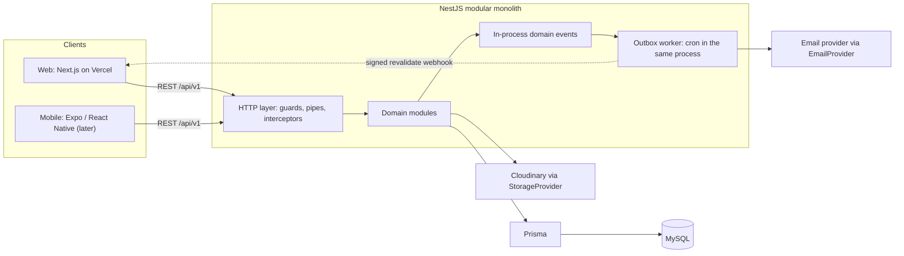
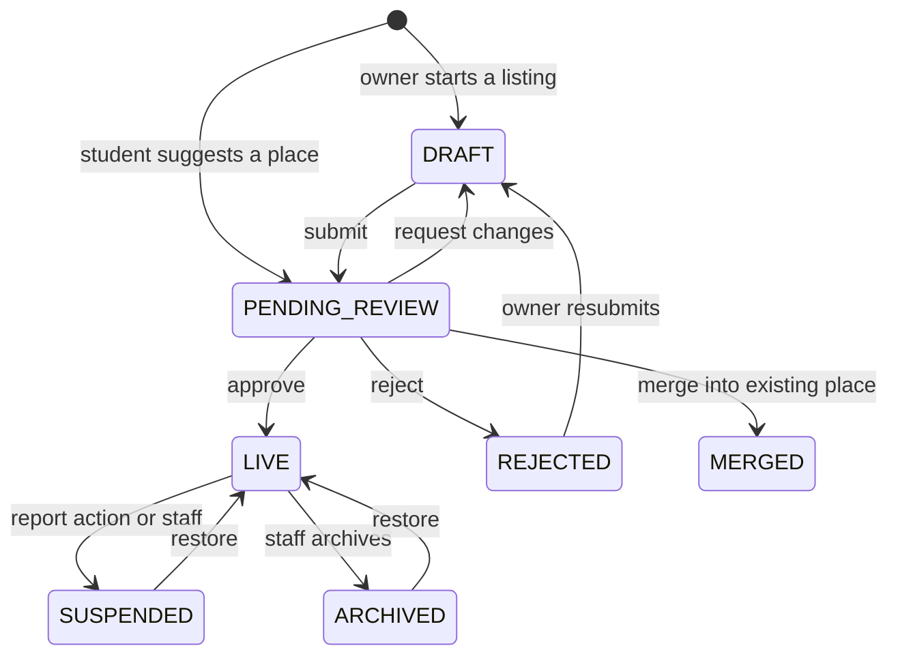
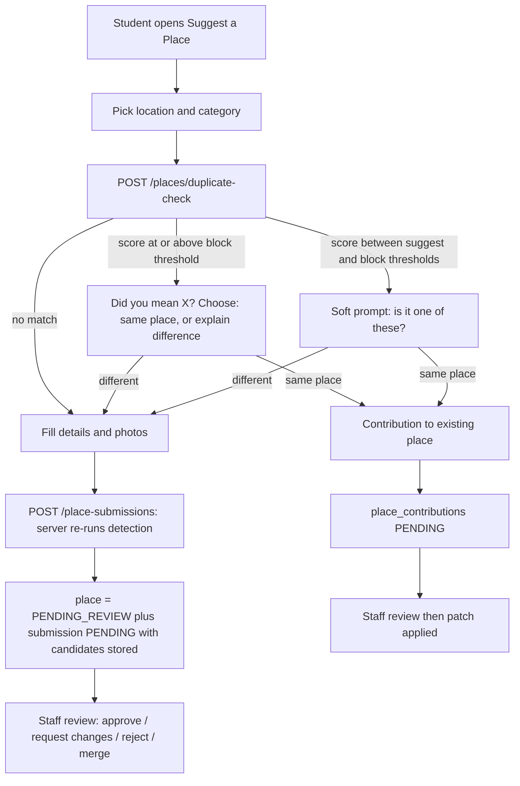
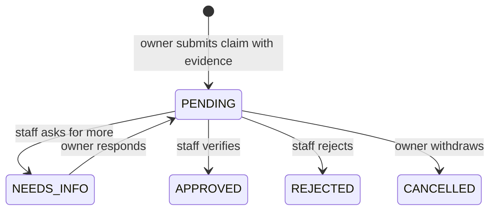
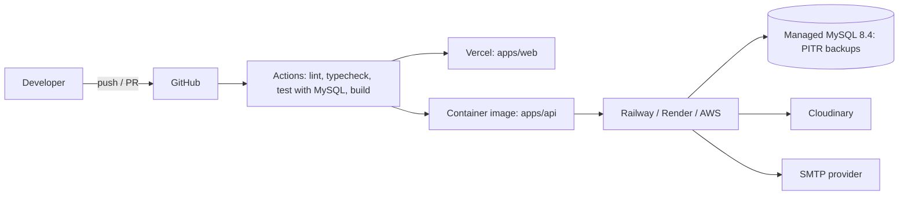

# 02 · Architecture

Answers spec §62 items **3** (architecture), **5** (API module structure), **13** (web + mobile sharing) and **14** (scalability/security decisions).

## 1. System context



**Hard rule:** business logic lives only in the NestJS API. Next.js renders and calls the API; it never touches the database and never re-implements a rule (open-now, distance, eligibility, permissions are all computed server-side so web and mobile always agree).

## 2. Technology choices

| Layer | Choice | Why / notes |
|---|---|---|
| Runtime | Node 24 LTS (installed: v24.16.0), TypeScript 6 strict, ESM modules | TypeScript 7 (native) is not yet supported by typescript-eslint or ts-jest. |
| Repo | npm workspaces monorepo | pnpm not installed; Expo-friendly. |
| API | NestJS 12 (ESM), Express, REST, URI versioning `/api/v1`, Swagger | Modular DI fits the module-boundary goal. |
| Validation | `zod` schemas in `@platform/contracts`, validated by NestJS 12's built-in `StandardSchemaValidationPipe`; Swagger documents the same schemas via `standardSchemaConverter` (D13, verified in a Phase 1 spike) | One schema for API validation, API docs, web forms, mobile forms and types. `nestjs-zod` is not used (no Nest 12 support). |
| DB / ORM | MySQL 8.4 LTS in production; **XAMPP (MariaDB 10.4.32) for local development**; Prisma 7.10 with `@prisma/adapter-mariadb` (Prisma 8 RC does not support MySQL yet) | Keep SQL portable between the two engines (risk T13). Compatibility is verified in Phase 2. |
| Auth | JWT access (HS256, 15 min) + opaque rotating refresh tokens; `@node-rs/argon2` (Argon2id) | Prebuilt binaries: no node-gyp on Windows. |
| Web | Next.js (App Router), React 19, Tailwind CSS v4, Radix primitives, `lucide-react`, TanStack Query, react-hook-form, `next-intl` | shadcn-style owned components, restyled to our tokens so it does not look like defaults. |
| Motion | CSS transitions first; `motion` only for gallery/sheets, lazy-loaded | Performance first. |
| Maps | MapLibre GL (picker only) + Google Maps URLs for navigation | D6. |
| Storage | Cloudinary behind `StorageProvider` | S3 + CDN later without touching callers. |
| Email | `EmailProvider` interface: `SmtpEmailProvider` (nodemailer: works with SES/Brevo/Resend SMTP), `ConsoleEmailProvider` (dev) | In development the console provider logs each email (including the verification link), so no SMTP account is needed. SMTP is configured later through environment variables. |
| Logging / errors | `pino` (JSON, request-id, PII redaction); Sentry optional | |
| Testing | Vitest for unit and end-to-end tests (Supertest over the real Nest app); a real database (XAMPP, separate test database) for DB-backed tests; Testing Library for components; Playwright for browser E2E | Mocks hide migration and query bugs. |
| CI/CD | GitHub Actions (lint, typecheck, test with MySQL service, build); Vercel (web); container on Railway/Render/AWS (API) | |

Dependencies are added only when a step needs them; each gets a one-line justification in the PR.

## 3. Repository layout

```
repo-root/                      # name is a placeholder; scope is neutral
├─ apps/
│  ├─ api/                      # @platform/api  (NestJS 12, ESM)
│  │  ├─ prisma/                # schema.prisma, migrations/, seed/
│  │  ├─ src/
│  │  │  ├─ main.ts, bootstrap.ts, swagger.ts, app.module.ts
│  │  │  ├─ common/             # http (envelope, errors, validation), swagger helpers
│  │  │  ├─ infra/              # config, database, logging (later: cache, events, storage, mail)
│  │  │  └─ modules/            # domain modules (section 4); health exists today
│  │  └─ test/                  # e2e (Supertest against the real Nest app)
│  ├─ web/                      # @platform/web  (Next.js 16, App Router, Tailwind 4)
│  └─ mobile/                   # Expo app: NOT created now
├─ packages/
│  ├─ contracts/                # zod schemas, error codes, envelope types
│  └─ api-client/               # typed fetch client used by web now and mobile later
├─ docs/
├─ .github/workflows/           # CI (added with the integration-testing phase)
├─ apps/api/.env.example        # API + database (XAMPP) settings
├─ apps/web/.env.example        # public web settings only
└─ package.json                 # npm workspaces
```

Module internals (example `places/`): `places.module.ts`, `places.controller.ts`, `places.admin.controller.ts`, `places.service.ts`, `places.repository.ts` (only for non-trivial queries), `proximity.service.ts`, `place-lifecycle.service.ts`, `policies/`, `mappers/`, `events/`, `*.spec.ts`.

## 4. Backend module map

| Module | Owns tables | Responsibility | Phase |
|---|---|---|---|
| Auth | `auth_tokens`, `refresh_tokens` | register, verify, login, refresh/rotate, logout, forgot/reset, sessions | 1 |
| Users | `users`, `student_profiles`, `device_tokens` | `/me`, profile, account deletion/anonymisation | 1 |
| Roles (RBAC) | `roles`, `permissions`, `role_permissions`, `user_roles` | permission resolution, staff management | 1 |
| Colleges (+ cities) | `cities`, `colleges`, `college_images` | catalogue, popularity, search | 1 |
| Categories | `categories`, `category_attributes`, `category_rating_dimensions`, `amenities`, `category_amenities` | dynamic taxonomy, attribute definitions, filter descriptors | 1 |
| Places | `places`, `place_*`, `college_places`, `saved_places`, `slug_redirects` | the central entity: CRUD, lifecycle, proximity, saves | 1 |
| Search | none (reads via provider) | `SearchProvider` (MySQL now, OpenSearch later), suggest, ranking | 1 |
| Submissions | `place_submissions`, `place_contributions` | suggest-a-place, duplicate detection, contributions | 1 |
| Claims | `place_claims`, `claim_evidence` | ownership claims and verification | 1 |
| Businesses | `business_profiles`, `business_members`, `leads` | owner profiles, listings entry point, leads | 1 |
| Reviews | `reviews`, `review_*` | reviews, ratings aggregation, owner replies | 1 |
| Reports | `reports` | unified report queue (place/review/listing/user/post) | 1 |
| Offers | `offers` | moderated offers | 1 (late) |
| Notifications | `notifications`, `outbound_messages` | in-app inbox, outbox worker, email/push/SMS/webhook providers | 1 |
| Uploads | `media_assets` | validation, storage abstraction, orphan cleanup | 1 |
| Analytics | `analytics_events`, `daily_stats` | event intake, rollups, owner/admin metrics | 1 |
| Audit | `audit_logs` | append-only audit trail | 1 |
| Admin | `app_settings` | dashboard aggregation, settings, staff, CSV imports (thin: business rules stay in domain modules) | 1 |
| Marketplace | `marketplace_*` | student marketplace | 2 |
| Community | `groups`, `posts`, … | groups, events, posts | 3 |

**Dependency rules**

- A module reads and writes **only its own tables**. Anything else goes through the owner's exported service or a domain event. `PlacesModule` is the only writer of place tables; Submissions, Claims and Reviews call `PlacesService`.
- Direction: `Submissions / Claims / Reviews / Reports / Offers / Businesses / Search → Places → Categories, Colleges, Uploads`. Reverse effects use events (`place.approved`, `review.created`, `claim.approved` …), so Notifications, Analytics, Search-indexing and web revalidation subscribe without being imported.
- Enforced by ESLint `no-restricted-imports` boundary rules plus review. This is also the seam for extracting Search → Notifications → Analytics later.
- Each domain module owns its own admin controller mounted under `/admin/...` (guarded by permission), so a feature's admin and public API sit together.

**Layering:** Controller (parse, authorise, serialise) → Service (business rules, transactions, policy checks) → Repository/Prisma (explicit `select`, never return raw rows) → mapper → response schema. Controllers hold no rules.

**Cross-cutting (`infra/`):** typed config (zod-validated env, fail fast), pino logger, Prisma service, global exception filter (error envelope), response interceptor (success envelope), zod validation pipe, throttler, `CachePort` (memory → Redis), event emitter, scheduler, health (`/api/v1/health`, `/api/v1/health/database`), audit.

**Request pipeline:** Helmet → CORS allow-list → request-id → throttler → `JwtAuthGuard` (deny-by-default; `@Public()` opt-out) → account-status check → `PermissionsGuard` → validation pipe → controller → service (+ ownership policy) → response interceptor → exception filter.

## 5. Domain designs

### 5.1 Auth & sessions

> **Implemented in Phase 3.** The design below is the target; this table records where the delivered code differs and why. Usage is in the [README](../README.md#authentication-and-access-control).
>
> | Topic | Design below | Implemented |
> |---|---|---|
> | Register | always `202`, email-enumeration safe | `201`, and `409 EMAIL_ALREADY_REGISTERED` for a duplicate (as specified for Phase 3). Accepts `name`, `email`, `password` only; college/course/year and the `BUSINESS_OWNER` choice come with the profile phases |
> | Account state | `PENDING_VERIFICATION` status | `emailVerifiedAt IS NULL`; `UserStatus` stays `ACTIVE` / `SUSPENDED` / `DEACTIVATED` |
> | Refresh token | opaque, cookie on web | a signed JWT (own secret `JWT_REFRESH_SECRET`, `typ=refresh`, random `jti`) returned **in the response body** for every client; only its SHA-256 is stored. The HttpOnly cookie arrives with the web auth UI |
> | Rotation | single-use with family reuse detection | same: `refresh_tokens.familyId` is the session; rotation is an atomic compare-and-set on `revokedAt`; replaying a rotated token (or losing a race) revokes the family and writes `REFRESH_TOKEN_REUSE_DETECTED` |
> | Lifetime | idle 30 d, absolute 60 d | rolling 30 d (each rotation extends it); no absolute cap yet |
> | Access token | `sub`, `roles[]`, `sid` | adds `email` and `typ`; 15 min; HS256 only (algorithm allow-list) |
> | Throttling | per IP **and** per account, progressive | per IP and per route (`AUTH_RATE_LIMIT`), in memory; no per-account limit yet |
> | Suspension | 60 s cached status check per request | not checked per request (stateless access token, max 15 min); refresh and `/auth/me` read the database |
> | Password policy | 10+ chars, no composition rules | 10-128 chars + three of four character classes (or a 16+ passphrase), common-password deny-list (leet-aware), no email name inside; Argon2id |
> | Tokens table | one `auth_tokens` table with a `type` | three tables: `refresh_tokens`, `email_verification_tokens`, `password_reset_tokens` |
> | Email | outbox table | `EmailProvider` abstraction (`console` for development, `memory` for tests); sent fire-and-forget so response time does not reveal whether an account exists. The outbox arrives with a real provider |

```mermaid
sequenceDiagram
  participant C as Client (web or mobile)
  participant A as API
  participant D as MySQL
  C->>A: POST /auth/login (email, password, X-Client)
  A->>D: load user, verify Argon2id
  A->>D: insert refresh token (hash, family id)
  A-->>C: 200 access token 15 min + refresh (cookie for web, body for mobile)
  C->>A: GET /me (Bearer access)
  C->>A: POST /auth/refresh
  A->>D: rotate: mark used, insert new; if reused, revoke whole family
  A-->>C: new access + new refresh
```

- **Register** always returns `202` (no account enumeration). Creates user `PENDING_VERIFICATION`, role `STUDENT` or `BUSINESS_OWNER`, `student_profiles` row (college, course, year), an `EMAIL_VERIFICATION` token (32 random bytes, only the SHA-256 stored, 24 h, single use) and an outbox email. If the address already exists and is verified, it receives an "you already have an account" email instead.
- **Login** verifies Argon2id in constant time (dummy hash for unknown emails). Unverified → `403 AUTH_EMAIL_NOT_VERIFIED` with resend option; suspended → `403 ACCOUNT_SUSPENDED`. Throttled per IP **and** per account with progressive delay (never a hard lockout, which would be a DoS lever).
- **Tokens:** access JWT HS256, 15 min, claims `sub`, `roles[]`, `sid`. Refresh is opaque (256-bit), stored hashed, **single-use with rotation**; presenting an already-rotated token revokes the whole family (theft signal) and audits it. Idle 30 days, absolute 60 days; staff sessions shorter.
- **Web:** access token in memory only (never localStorage). Refresh token in an `HttpOnly; Secure; SameSite=Lax; Path=/api/v1/auth; Domain=.<site>` cookie. `POST /auth/refresh` also requires the custom header `X-Client: web` (forces a CORS preflight, so it cannot be forged cross-site). On page load the app calls refresh to bootstrap the session.
- **Domains:** production uses `app.<domain>` and `api.<domain>` (same site). Local dev on `localhost:3000` (web) and `localhost:3001` (API) is same-site already. Vercel preview deployments proxy `/api/v1/*` through a Next rewrite.
- **Mobile:** same endpoints with `X-Client: android|ios`; refresh token returned in the response body and kept in SecureStore.
- **Password policy:** min 10 chars, max 128, no composition rules, bundled common-password denylist.
- **Suspension:** revokes all refresh tokens; the JWT strategy checks a 60 s cached account status and session id, so suspended users lose access within a minute rather than 15.
- **Phone OTP later, no redesign:** `users.phone` / `phone_verified_at` already exist (nullable); `auth_tokens.type` includes `PHONE_OTP`; `outbound_messages.channel` includes `SMS`; login goes through a `CredentialStrategy` interface (`password` now, `otp` later). Note: commercial SMS in India requires TRAI DLT registration, which has a lead time. Start it early if OTP is planned (WhatsApp OTP is an alternative).
- **Staff:** SUPER_ADMIN created by a CLI command from env (never a default credential). TOTP 2FA required for staff before public launch.

### 5.2 RBAC and policy (two layers)

1. **Coarse:** roles ↔ permissions in DB (`roles`, `permissions`, `role_permissions`, `user_roles`). JWT carries role keys only; `PermissionsService` resolves permissions from a cached role→permission map. Endpoints declare `@RequirePermissions('place.moderate')`.
2. **Fine:** resource policies inside services, e.g. `PlacePolicy.canEdit(user, place)` = staff with `place.update`, **or** an active member (`OWNER`/`MANAGER`) of `place.business_id`. Every mutation states both layers. Matrix: [07-rbac](07-rbac.md).

A user may hold several roles (a student whose family runs a mess). Roles are additive.

### 5.3 Place lifecycle



Separate axes so states stay simple:

- `operating_status`: `OPEN`, `TEMPORARILY_CLOSED`, `PERMANENTLY_CLOSED`. A "business closed" report resolves here; the page stays (SEO, history) with a banner and is removed from lists.
- `verification_level`: `NONE`, `OWNER_CLAIMED`, `VERIFIED`.
- Public queries always go through one `livePlaces` scope (`status = LIVE`, not demo in prod). A lint-level repository rule prevents ad-hoc queries that skip it.
- Slug is allocated when a place first goes `LIVE`; renames write `slug_redirects` so URLs and SEO survive.

### 5.4 Flexible category data

- `categories` is a two-level tree (`parent_id`): groups (Accommodation, Food, Study, Daily Needs, Transport) → categories. Fully data-driven; `scope` (`PLACE`, `MARKETPLACE`) lets Phase 2 reuse the table.
- `category_attributes` defines typed fields per category (`BOOLEAN`, `INTEGER`, `DECIMAL`, `TEXT`, `ENUM`, `MULTI_ENUM`, `DATE`) with flags `is_required`, `is_filterable`, `is_highlight`. Values are stored typed in `place_attribute_values` so filters use real indexes. New attribute = one admin action, **no migration**.
- A `PlaceAttributesValidator` builds a zod schema at runtime from the definitions (cached), so web, mobile and CSV import validate identically.
- `GET /categories/:slug` returns a **filter descriptor** (from filterable attributes + amenities + price unit). The UI renders filter controls from data, so nothing category-specific is hard-coded in frontend logic.
- **Prices:** `place_price_options` rows (label, amount, unit) + denormalised `price_min/max/unit` on `places`. Each category declares a canonical `default_price_unit` so "cheapest" compares like with like (monthly with monthly).
- **Hours:** `place_hours` uses minutes-from-midnight; several slots per day (mess: breakfast/lunch/dinner); `closes ≤ opens` means it crosses midnight; `hours_status` (`UNKNOWN`, `SCHEDULED`, `ALWAYS_OPEN`) distinguishes "no data" from "closed". The API computes `isOpenNow` and `nextChange` in the place's timezone (`Asia/Kolkata` default), returning `null` when unknown.
- **Amenities** are a global master list (icon, group) scoped to categories via `category_amenities`; typed values live in attributes.

### 5.5 Distance and proximity

> **Implemented in Phase 4 for colleges:** `CollegeProximityService` (`modules/colleges`) owns the college -> place links: bounding-box query, exact Haversine, minimal writes (only rows that change), inside the caller's transaction. It is exported so the places phase can call it when a place is created or moved. The nightly reconcile job and place-side triggers are not built yet. "Near me" for colleges is a `lat`/`lng` on `GET /colleges` (distance computed in code); it needs no raw SQL at directory scale.

- Coordinates are the only source of truth. `college_places(college_id, place_id, distance_m, mode)` is **derived**: a `ProximityService` computes Haversine distance for every place within the college's `service_radius_m` (default 5 km) and upserts rows. `mode` is `AUTO`, `PINNED` (staff force-include beyond radius) or `EXCLUDED`.
- Recomputed on: place goes live / coordinates change, college created / moved / radius changed, and a nightly reconcile job. One service owns this so the rule exists once.
- A place can appear under many colleges (spec §34); the UI shows distance from the **selected** college.
- Hot query: `college_places` (index `(college_id, distance_m)`) joined to `places` filtered by status/category, `ORDER BY distance_m, place_id`.
- Sorts: nearest (`distance_m`), cheapest (`price_min` within the category's canonical unit), top-rated (`rating_score`, a Bayesian average so one 5★ review does not outrank forty 4.6★ reviews), newest (`published_at`).
- "Near me" (arbitrary lat/lng): city scope → bounding box → Haversine, via one raw-SQL repository method.
- UI copy is honest: "≈ 850 m" (straight-line) and "≈ 11 min walk" (`distance × 1.3 / 80 m/min`, computed at read time). Road routing is a later, paid enhancement.

### 5.6 Search

- `SearchProvider` interface: `searchPlaces`, `searchColleges`, `searchCategories`, `searchBusinesses`, `suggest`. Today `MySqlSearchProvider`; later `OpenSearchProvider` populated from `place.changed` events, with no caller changes.
- MySQL strategy: normalise (NFKC, lowercase, diacritics, light Indic spelling folding) → indexed prefix on `name_normalized` for autocomplete → `FULLTEXT(name, search_keywords, description)` in boolean mode for relevance. Boolean operators in user input are stripped to prevent query-syntax abuse.
- v1 ranking (weights in `app_settings`): `0.5 text + 0.2 proximity + 0.2 rating_score + 0.1 verified`. Sponsored placements (Phase 4) are additive, capped and labelled, never mixed into organic ranking silently.
- Every search writes an analytics event; zero-result queries are reviewed weekly (they show missing data and missing synonyms).
- **Move to OpenSearch when:** p95 search > 300 ms at ~100k places, or typo tolerance / Marathi analysers / geo-boosted relevance become product requirements.

### 5.7 Suggest a Place, duplicates, contributions



- **Data vs workflow:** the new place row exists in `PENDING_REVIEW`; `place_submissions` records the workflow. Requested changes move the place to `DRAFT` and the submission to `NEEDS_CHANGES`; resubmission creates a new submission row (history preserved).
- **Detection v1** (`DuplicateDetectionService`, thresholds in `app_settings`):
  - *Candidate pool:* same `city_id`; statuses `LIVE`, `PENDING_REVIEW`, `SUSPENDED`, `ARCHIVED`; within ~300 m (bounding box on `(city_id, latitude, longitude)`); plus exact phone match anywhere in the city; plus exact normalised-name match within 2 km. **Pending suggestions are candidates too**, so 100 students suggesting "ABC Mess" collapse onto one pending place and the rest become `CONFIRMATION` contributions.
  - *Name score:* normalise (lowercase, strip punctuation, remove category words like "mess", "hostel", "pg", fold Indic spelling variants such as `aa→a`, `w→v`, `ph→f`, transliterate Devanagari), then `max(Jaro-Winkler, IDF-weighted token Dice)`. IDF is computed over the city's names so common tokens ("Sai", "Shree") count less.
  - *Other signals:* geo decay (1.0 at ≤ 50 m → 0 at 300 m), category match (same category > same group > different group), address-token overlap (low weight), phone match (strong).
  - *Composite:* `0.45 name + 0.25 geo + 0.15 category + 0.10 address + 0.05 phone`, with overrides: exact phone match → ≥ 0.90; name ≥ 0.92 within 100 m → ≥ 0.90.
  - *Outcome:* `≥ dup.block (0.85)`: student must pick "same place" or explicitly justify "different". `dup.suggest (0.60)–0.85`: soft prompt. Top 3 candidates with human-readable reasons ("Same name · 40 m away · same category").
  - Runs client-triggered (as-you-type) **and again server-side on submit** (never trust the client); candidates are stored on the submission for the reviewer.
- **Merge:** reviewer picks the canonical place; submission → `MERGED`; the pending place → `MERGED` with `merged_into_id`; non-conflicting fields become a contribution to the canonical place; the submitter is thanked and notified.
- **Contributions** are field-level patches (allow-listed by type and by category attributes) with a `base_version` (from `places.version`); a stale patch shows a diff to the reviewer. Types: `FIELD_UPDATE`, `PRICE_UPDATE`, `HOURS_UPDATE`, `PHOTO_ADD`, `CONFIRMATION`.
- **Abuse controls:** per-user daily quotas (default 5 submissions / 20 contributions, lower for accounts < 24 h old), content-hash dedupe on photos, URL/keyword filter on text.
- **Owner edits (D2):** the same contribution mechanism with `source = OWNER`; low-risk fields `AUTO_APPLIED`, high-risk `PENDING`.

### 5.8 Claims



- The Claim CTA shows on unclaimed places. Claimed places show "Managed by <business>" instead.
- **Verification:** staff call the number on record (preferred), or review a shop photo showing signage or a licence. Evidence is stored as **private** media (signed URLs, staff only) and purged after a retention window. We deliberately do not collect government IDs (data minimisation).
- Several pending claims for one place may coexist. **Approval is transactional:** set `places.business_id`, `verification_level = OWNER_CLAIMED` (`VERIFIED` if staff also confirmed details), auto-reject competing claims with notifications, write audit. Staff can unlink an owner with a recorded reason.
- "One pending claim per (place, business)" is enforced with a nullable unique `active_key` column (`placeId:businessId` while the claim is open, `NULL` once decided), maintained by the service in the same transaction. MySQL/MariaDB unique indexes allow many `NULL`s, so this works without partial indexes or generated columns.

### 5.9 Reviews

- One review per user per place (unique). Overall 1–5 plus optional per-dimension ratings (dimensions are per category: Mess → Food/Price/Hygiene; PG → Cleanliness/Safety/Value; data-driven). Text ≤ 2,000 chars, up to 3 photos.
- **Aggregates** (`rating_avg`, `rating_count`, `rating_score`, `rating_stats` JSON with histogram and dimension averages) are recomputed **in the same transaction** as any review create/edit/hide.
- Published immediately (post-moderation, D3). Owners can **reply once** (`review_replies`) and can **report** a review, but can never hide or delete one. Staff hide/remove; removed content is retained for legal hold and audit.

### 5.10 Reports and moderation

- One `reports` table: `target_type` (`PLACE`, `REVIEW`, `MARKETPLACE_LISTING`, `USER`, `COMMUNITY_POST`), `target_id`, `reason` (spec §16 list), `details`, `status` (`PENDING → IN_REVIEW → RESOLVED / DISMISSED`), assignee, resolver, note.
- Queue is ranked by distinct-reporter count and reason severity. Resolution actions call the owning module (suspend place, mark closed, hide review), each audited. The reporter is notified of the outcome (not of others' details).
- Abuse controls: throttling, one open report per (reporter, target, reason), reporter accuracy tracked for weighting. **Auto-hide** applies only to `SPAM`/`INAPPROPRIATE` on reviews at ≥ 3 distinct reporters (configurable); factual disputes never auto-hide, so mass-reporting cannot silence a fair review.
- **Nothing important is hard-deleted.** Moderation history is retained; user erasure requests anonymise the author while content retention follows legal need.

### 5.11 Notifications and email (outbox)

- `NotificationService.notify(userId, event, payload)` writes an in-app `notifications` row and enqueues `outbound_messages` per channel. Transactional mail (verification, reset) enqueues directly.
- **Outbox:** a scheduled worker claims work with a portable two-step: `UPDATE outbound_messages SET status = SENDING, locked_by = ?, locked_at = now() WHERE status = PENDING AND next_attempt_at <= now() ORDER BY id LIMIT 50`, then reads back the rows it locked. This is multi-instance-safe with **no Redis** and works on XAMPP's MariaDB 10.4 (which lacks `SKIP LOCKED`). Backoff 1 m → 5 m → 30 m → 2 h → 12 h, then `FAILED`. `dedupe_key` makes enqueue idempotent. Payloads with secrets (verification/reset links) are redacted after send.
- Channels: `EMAIL`, `PUSH`, `SMS`, `WEBHOOK` (also used for web revalidation). Providers sit behind interfaces, so switching SES/Brevo/Resend or adding Expo/FCM push changes no caller.
- Email templates are typed functions (HTML + text). React Email/MJML only if needed later.

| Event | Recipient | Channels (Phase 1) |
|---|---|---|
| Registration | user | email (verify) |
| Password reset requested / done | user | email |
| Listing submitted / approved / rejected / changes requested | submitter (owner) | in-app + email |
| Student suggestion approved / rejected / merged | student | in-app |
| Claim submitted | owner (+ staff in-app) | email + in-app |
| Claim approved / rejected / needs info | owner | email + in-app |
| Review received / owner replied | owner / student | in-app |
| Report resolved | reporter | in-app |
| Lead received | owner | in-app + email |
| Contribution approved | contributor | in-app |

### 5.12 Uploads and media

- `POST /uploads/images` (multipart, JSON body limit 1 MB, multipart 6 MB). Server validates **magic bytes** (`file-type`), never `Content-Type` or extension; JPEG/PNG/WebP; ≤ 5 MB; 200–8,000 px; EXIF/GPS stripped; SHA-256 dedupe; per-entity caps (place 10, review 3); 20 uploads/hour/user.
- Returns a `media_assets` id in state `TEMP`; attached on entity save; a job deletes `TEMP` assets older than 24 h from storage.
- Delivery: provider URL with fixed presets (`f_auto,q_auto,w_…,c_fill`) through a `next/image` custom loader. Claim evidence uses **private/authenticated** delivery with short-lived signed URLs.
- Proxying through the API is right at this scale (strict validation, simple security story). Signed direct-to-storage upload is a later optimisation behind the same interface.
- Image moderation is manual (reports) in Phase 1.

### 5.13 Analytics

- `AnalyticsService.track()` buffers in memory (flush every 5 s or 100 events) into `analytics_events`. A nightly job rolls up into `daily_stats`; owner dashboards read rollups plus today's live count.
- Events: registration, college selected, place view, search, save/unsave, call/WhatsApp/directions click, lead, business profile view, submission.
- **Privacy:** no IP stored; `session_hash = SHA-256(daily_salt + anonymous_session_id)`; no fingerprinting; views deduped per session per place per 30 min; obvious bots filtered; raw events kept ≈ 180 days, rollups indefinitely. `user_id` is stored only for first-party actions (saves, leads, submissions).
- Product analytics beyond business-facing metrics should use a dedicated tool later rather than growing this table.

### 5.14 Caching and revalidation

- Public GETs are **user-agnostic** and cacheable: `Cache-Control: public, s-maxage=60, stale-while-revalidate=300` + ETag. Per-user data (`isSaved`, etc.) comes from `/me/*` (`no-store`) and is overlaid client-side.
- In-process TTL cache (behind `CachePort`) for reference data (category tree, amenities, role→permission map), invalidated on admin writes.
- Next.js `fetch(..., { next: { revalidate: 300, tags: ['place:<slug>', 'college:<slug>'] } })`; `place.changed` → `WEBHOOK` outbox message → `POST /api/revalidate` (HMAC-signed) → `revalidateTag`. Failure never blocks the write.

## 6. Web and mobile share one API

| Concern | Shared mechanism | Web | Mobile (later) |
|---|---|---|---|
| Contract + validation | `@platform/contracts` (zod schemas, inferred types, enums, error codes) | react-hook-form + zod resolver | same schemas in RN forms |
| HTTP client | `@platform/api-client` (typed, fetch-based, refresh logic, pluggable `TokenStore`) | in-memory token + cookie refresh | SecureStore token store, refresh in body |
| Auth | same `/auth/*` endpoints | httpOnly cookie | body tokens via `X-Client` |
| Business rules | server only (open-now, distance, eligibility, permissions, price comparability) | none | none |
| Design tokens | Today: CSS variables in `apps/web/src/app/globals.css` (Tailwind `@theme`). Extracted to a shared `@platform/design-tokens` package when the mobile app starts | Tailwind theme (web) | NativeWind / StyleSheet |
| Deep links | identical paths `/places/:slug`, `/colleges/:slug` | pages | Android App Links |
| Push | `POST /me/devices` + `PUSH` channel in outbox | n/a | Expo push / FCM |
| Images | one URL helper with transformation presets | `next/image` loader | same URLs |
| Versioning | `/v1` additive-only; breaking → `/v2`; `X-App-Version`; `GET /meta/client-config` (min version, flags, maintenance) | | force-update support |
| i18n | machine-readable `error.code` + message keys | `next-intl` | same keys |

The mobile app therefore adds **zero** backend work beyond device-token registration: same users, same auth, same database.

## 7. Security decisions

| Threat | Control |
|---|---|
| Credential stuffing / brute force | Argon2id; per-IP and per-account throttling with progressive delay; generic errors; timing equalisation |
| Token theft | 15-min access token, rotating refresh with reuse detection, httpOnly cookie, in-memory access token, no localStorage |
| CSRF | `SameSite=Lax`, custom-header requirement on refresh, strict CORS allow-list, mutations only via JSON POST/PATCH/PUT/DELETE |
| XSS | React escaping; **no** `dangerouslySetInnerHTML` for user content; text normalised and control characters/HTML stripped server-side; nonce-based CSP, `X-Content-Type-Options`, `Referrer-Policy`, `frame-ancestors 'none'` |
| Injection | Prisma parameterisation; raw SQL only through tagged templates; lint bans `$queryRawUnsafe`; FULLTEXT operator stripping |
| Broken access control / IDOR | deny-by-default global guard; RBAC + resource policy on every mutation; table-driven permission tests generated from [07-rbac](07-rbac.md) |
| Mass assignment | strict zod schemas (`.strict()`), explicit `select`, response whitelisting so `password_hash` cannot leak |
| Upload abuse | magic-byte sniffing, size/dimension caps, rate limits, EXIF strip, private evidence storage |
| Enumeration | 202 on register/forgot; UUID/slug identifiers |
| Spam / fake content | quotas, new-account limits, report throttling, keyword/URL filters, photo hash dedupe |
| SSRF | no server-side fetching of user-supplied URLs in Phase 1 (Google short-link resolution deferred) |
| Secrets | env-only, validated at boot, `.env.example` only, gitleaks in CI, nothing sensitive in `NEXT_PUBLIC_*` |
| Supply chain | lockfile, Dependabot, `npm audit` in CI, minimal dependencies |
| Privacy | data minimisation, hashed session ids, consent recorded for contact sharing, anonymise-on-delete job, log redaction, retention windows |
| Admin safety | append-only audit (app DB user has INSERT/SELECT only on `audit_logs`), staff 2FA, shorter staff sessions, destructive actions soft |
| Availability | request-size limits, timeouts, DB pool caps, health checks, throttling |

## 8. Scalability decisions and growth triggers

| Concern | Phase 1 approach | Trigger to evolve | Evolution |
|---|---|---|---|
| API compute | stateless, 12-factor, horizontally scalable | CPU > 60 % sustained | add instances (requires Redis for throttle + cache) |
| DB reads | indexes, denormalised aggregates, `college_places`, pagination caps (max 50) | p95 query > 100 ms or DB CPU high | read replica, then caching |
| Search | MySQL FULLTEXT + prefix | ~100k places, typo tolerance, Marathi analysers | OpenSearch behind `SearchProvider` |
| Background work | DB outbox + scheduler in API process | > ~10 msgs/s or long jobs | separate worker entrypoint (same codebase), then BullMQ + Redis |
| Cache | in-memory | > 1 API instance | Redis via `CachePort` |
| Media | Cloudinary | cost or limits | S3 + CDN/imgproxy behind `StorageProvider` |
| Event tables | monthly partitions, retention jobs | > ~50M rows | export to a warehouse (ClickHouse/BigQuery) |
| Modularity | strict table ownership, in-process events | team or load growth | extract Search → Notifications → Analytics first |
| Geography | city-scoped queries | multi-city growth | `city_id` prefilter (already) + geohash column if profiling demands |

No microservices in Phase 1. IDs: **UUIDv7** (time-ordered, index-friendly) for entities; `BIGINT AUTO_INCREMENT` for append-only high-volume tables (`audit_logs`, `analytics_events`, `outbound_messages`) that are never exposed.

## 9. Deployment topology, environments, CI/CD



- **Environments:** local (XAMPP MySQL, emails logged to the console) · preview (web only → staging API) · staging · production. Separate DBs and secrets each.
- **Domains:** `www`/`app.<domain>` (web), `api.<domain>` (API), media via provider CDN.
- **Migrations:** `prisma migrate deploy` as an explicit release step, never at app boot. Shadow DB only in dev/CI.
- **API image:** multi-stage Dockerfile, non-root user, portable to ECS/App Runner/Fly/Render. This keeps the AWS/GCP move a redeploy, not a rewrite.
- **Backups:** managed point-in-time recovery + a periodic restore test.
- **Feature flags / thresholds:** `app_settings` (SUPER_ADMIN editable, audited).

## 10. Observability

Structured pino logs (request id, user id only, route, latency, status), Sentry with PII scrubbing (optional), `/api/v1/health` (liveness) and `/api/v1/health/database` (DB ping), uptime monitor, later `/metrics`. Business KPIs come from `daily_stats`. Alert on: 5xx rate, p95 latency, outbox backlog age, failed-message count, auth refresh-reuse events.
