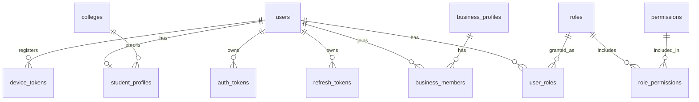
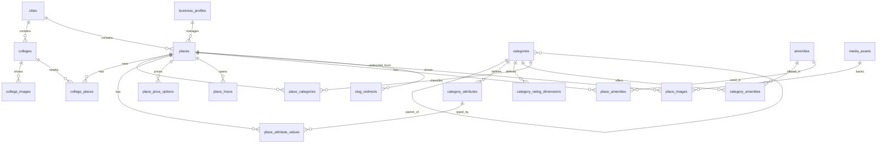
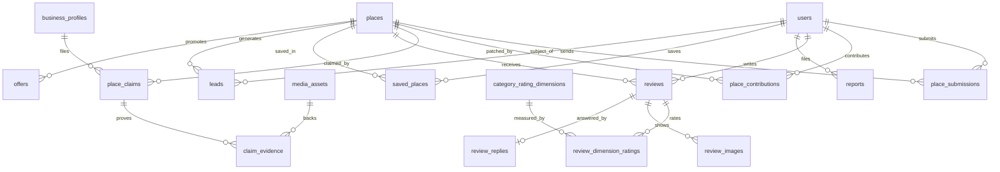
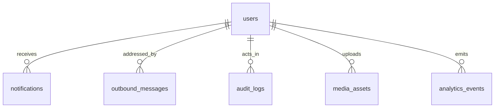

# 03 · Database design (MySQL / MariaDB + Prisma)

Answers spec §62 item **4** (ERD / schema design).

## 0. Implemented schema (Phase 2): read this first

The database was built in **Phase 2**. **`apps/api/prisma/schema.prisma` and the migration `apps/api/prisma/migrations/20260919172259_initial_schema/` are the source of truth.** Where the design in sections 1–6 below differs, the implemented schema wins; those sections remain as the design reference for the tables that are still to come. The implementation has **32 tables**. Columns are camelCase (Prisma's default), tables are snake_case, ids are UUIDv7 `CHAR(36)`.

### Where the implementation differs from the original design

| Topic | Original design | Implemented in Phase 2 | Why |
|---|---|---|---|
| Student profile | `student_profiles` table | `collegeId`, `course`, `year` columns on `users` | The Phase 2 brief specifies them on User; simpler for the MVP |
| Email verification and status | `email_verified_at` + status `PENDING_VERIFICATION` | `emailVerifiedAt` (null = not verified) and `UserStatus` = `ACTIVE`, `SUSPENDED`, `DEACTIVATED` | Verification and moderation state are independent |
| Place lifecycle | `PENDING_REVIEW`, `LIVE`, `SUSPENDED`, `ARCHIVED`, `MERGED` and a 3-level `verification_level` | `PlaceStatus` = `DRAFT`, `PENDING`, `ACTIVE`, `INACTIVE`, `REJECTED` and `VerificationStatus` = `PENDING`, `VERIFIED`, `REJECTED` | Enums specified in the Phase 2 brief. "Owner claimed" is simply `places.businessProfileId IS NOT NULL` |
| Student submissions | Data lives in `places` with `place_submissions` as a workflow record | **`place_submissions` holds the proposed data** (+ `place_submission_images`). Approval creates a `Place` (`resultingPlaceId`) or marks the submission `DUPLICATE` (`duplicateOfPlaceId`). Business-owned listings are `Place` rows in `DRAFT`/`PENDING` | The brief defines the submission fields; keeps `places` free of unreviewed student data |
| Reporting | One unified `reports` table | `review_reports` (FK-enforced, one report per user per review) **and** the generic `reports` | The brief lists both. The overlap is to be resolved in the reports phase (15) |
| Cities | `cities` table | Plain `city`, `state`, `country` columns on colleges and places | The brief specifies columns; add a `cities` table when the second city launches |
| Review ratings | Dimension table | `category_rating_dimensions` + `review_ratings` (no fixed food/price columns) | Flexible per category, as the brief allows |
| Ids | UUIDv7 for entities, BIGINT for append-only logs | UUIDv7 `CHAR(36)` everywhere, including `audit_logs` | One id style, no BigInt serialisation surprises |
| Opening hours | Minutes since midnight | `HH:mm` strings + `is24Hours` + `isClosed`, validated by CHECK constraints | Human-readable; matches the brief's `openTime` / `closeTime` |
| Xerox / printing | One merged category | Two categories, `xerox` and `printing` | The brief lists them separately |
| Claim uniqueness | Generated-column unique index | Nullable unique `activeKey` (`placeId:businessProfileId` while open, `NULL` once decided) | Works on MariaDB 10.4 and MySQL 8 without engine-specific features |
| Schema files | One file per domain | A single `schema.prisma` | The brief asks for `prisma/schema.prisma` |
| Not created yet | | `auth_tokens`, `refresh_tokens`, `media_assets`, `outbound_messages`, `analytics_events`, `daily_stats`, `app_settings`, `leads`, `offers`, `device_tokens`, `slug_redirects`, `review_replies`, FULLTEXT indexes | Added by the phase that needs them (authentication, uploads, search, ...) |

### Where the brief's example category fields live

| Brief's field | Stored as |
|---|---|
| `monthly_price`, `daily_price`, `monthly_rent` | `place_price_options` rows (label + amount + unit), summarised in `places.priceMin/priceMax/priceUnit`; a PG can have single/double/triple prices |
| `timing`, `open_24_hours` | `place_hours` rows (several slots per day, `is24Hours`, `isClosed`) |
| `ac`, `wifi`, `charging`, `attached_bathroom`, `food` | The normalised amenity list (`amenities` + `place_amenities`) |
| `veg_nonveg`, `breakfast`, `lunch`, `dinner`, `seating_capacity`, `gender`, `occupancy_type`, `deposit`, `furniture`, `available_from`, ... | `category_attributes` (definitions) + `place_attribute_values` (typed values) |

### Verified on XAMPP (MariaDB 10.4.32)

The migration applies cleanly and `migrate status` reports it up to date with no drift. All 32 tables, 56 foreign keys and 23 CHECK constraints exist. The 6 `JSON` columns round-trip as real JSON through Prisma. `utf8mb4` stores Devanagari. Everything is covered by `npm run test:db` (33 tests against the real database). **One limitation:** Prisma Studio cannot load its table list on MariaDB 10.4 (it needs `JSON_ARRAYAGG`, added in MariaDB 10.5); use phpMyAdmin.

---

*Sections 1–6 below are the original design reference.*

## 1. Conventions

- Tables `snake_case` plural; Prisma models `PascalCase` with `@@map`. Prisma schema split by domain into multiple files (confirm the installed Prisma version supports this without a preview flag).
- **PK:** `CHAR(36)` **UUIDv7** (app-generated, time-ordered). Append-only high-volume tables (`audit_logs`, `analytics_events`, `outbound_messages`) use `BIGINT AUTO_INCREMENT` and are never exposed. Verify `@default(uuid(7))` support at Step 3; fall back to cuid2.
- **Timestamps:** `DATETIME(3)` UTC (`created_at`, `updated_at`); `deleted_at` only where retention or audit needs it.
- **Coordinates** `DOUBLE`; **money** `INT` whole rupees (+ `currency CHAR(3) DEFAULT 'INR'` where relevant); **ratings** `TINYINT`; **aggregates** `FLOAT`/`INT`.
- Charset `utf8mb4`, collation `utf8mb4_unicode_ci` (case- and accent-insensitive, Devanagari-safe, and available on both MySQL and MariaDB). `utf8mb4_0900_ai_ci` is MySQL-8-only and is deliberately not used, because local development runs on XAMPP's MariaDB 10.4 (risk T13). `JSON` columns are verified against MariaDB in Phase 2.
- **FKs:** `RESTRICT` by default (history is preserved), `CASCADE` only for pure join tables and owned children, `SET NULL` for optional actor references.
- **Enums:** MySQL ENUM (via Prisma enum) for closed workflow states; lookup tables (`roles`, `categories`, …) for open, admin-managed sets.
- Things Prisma cannot express are written as raw SQL inside the migration: `CHECK` constraints (rating 1–5, latitude −90..90, longitude −180..180). Avoid engine-specific features (partial indexes, generated columns, `SKIP LOCKED`) so the schema behaves the same on MariaDB 10.4 and MySQL 8.4.

## 2. ERD

### 2.1 Identity and access



### 2.2 Geography, catalogue and places



### 2.3 Contribution, ownership and trust



### 2.4 Platform



`reports` targets are polymorphic (`target_type` + `target_id`), so no foreign key is drawn. Integrity is enforced in `ReportsService`.

## 3. Tables

Legend: `UQ` unique · `IX` index · `FT` fulltext · `FK` foreign key. Phase: **1** MVP, **1b** late Phase 1, **2** marketplace, **3** community.

### 3.1 Identity and access

| Table | Columns (key ones) | Constraints / indexes | Ph |
|---|---|---|---|
| `users` | id, email UQ (lowercased), email_verified_at, password_hash, phone UQ NULL, phone_verified_at, name, avatar_media_id FK NULL, status ENUM(PENDING_VERIFICATION, ACTIVE, SUSPENDED, DELETED), locale, last_login_at, deleted_at, created_at, updated_at | IX(status, created_at) | 1 |
| `roles` | id, key UQ (SUPER_ADMIN, ADMIN, MODERATOR, STUDENT, BUSINESS_OWNER), name, description, is_system | | 1 |
| `permissions` | id, key UQ (e.g. `place.moderate`), group, description | | 1 |
| `role_permissions` | role_id, permission_id | PK(role_id, permission_id) | 1 |
| `user_roles` | user_id, role_id, granted_by FK NULL, granted_at | PK(user_id, role_id); IX(role_id) | 1 |
| `student_profiles` | user_id PK/FK, college_id FK, course, year_of_study TINYINT, graduation_year NULL | IX(college_id) | 1 |
| `auth_tokens` | id, user_id FK, type ENUM(EMAIL_VERIFICATION, PASSWORD_RESET, EMAIL_CHANGE, PHONE_OTP), token_hash UQ, target, expires_at, consumed_at, attempts, created_at | IX(user_id, type); IX(expires_at) | 1 |
| `refresh_tokens` | id, user_id FK, family_id, token_hash UQ, client_type ENUM(WEB, ANDROID, IOS), device_label, user_agent, expires_at, revoked_at, replaced_by_id NULL, last_used_at, created_at | IX(user_id); IX(family_id); IX(expires_at) | 1 |
| `device_tokens` | id, user_id FK, platform, token UQ, last_seen_at | IX(user_id) | 1b |

### 3.2 Geography and colleges

| Table | Columns | Constraints / indexes | Ph |
|---|---|---|---|
| `cities` | id, name, slug UQ, state, country CHAR(2), latitude, longitude, timezone (default `Asia/Kolkata`), aliases JSON (`["Ahmednagar"]`), is_launched, sort_order | IX(is_launched, sort_order) | 1 |
| `colleges` | id, city_id FK, name, short_name, slug UQ, description, affiliation, address_line, pincode, latitude, longitude, website, logo_media_id FK NULL, cover_media_id FK NULL, service_radius_m INT DEFAULT 5000, status ENUM(DRAFT, ACTIVE, INACTIVE), verified_at, place_count INT (denormalised), created_by FK, created_at, updated_at | IX(city_id, status); IX(latitude, longitude); FT(name, short_name) | 1 |
| `college_images` | id, college_id FK, media_asset_id FK, sort_order, alt_text | IX(college_id) | 1 |

`cities` exists so expansion ("later other cities") is data, not code: launch gating, city hub pages, aliases such as the former name **Ahmednagar** for search and SEO.

### 3.3 Catalogue

| Table | Columns | Constraints / indexes | Ph |
|---|---|---|---|
| `categories` | id, parent_id FK NULL, scope ENUM(PLACE, MARKETPLACE), name, slug, description, icon (key from a fixed allow-list), default_price_unit, sort_order, is_active | UQ(scope, slug); IX(scope, parent_id, is_active, sort_order) | 1 |
| `category_attributes` | id, category_id FK, key, label, help_text, data_type ENUM(BOOLEAN, INTEGER, DECIMAL, TEXT, ENUM, MULTI_ENUM, DATE), options JSON, unit, constraints JSON, is_required, is_filterable, is_highlight, sort_order, is_active | UQ(category_id, key) | 1 |
| `category_rating_dimensions` | id, category_id FK, key, label, sort_order | UQ(category_id, key) | 1 |
| `amenities` | id, key UQ, label, icon, group, sort_order, is_active | | 1 |
| `category_amenities` | category_id, amenity_id | PK(category_id, amenity_id) | 1 |

### 3.4 Places

**`places`**

```
id, slug UQ NULL (allocated at first LIVE), name, name_normalized, description TEXT,
city_id FK, address_line, locality, pincode,
latitude, longitude, location_source ENUM(PIN_DROP, DEVICE_GPS, PASTED_LINK, STAFF_VERIFIED),
phone, whatsapp, email, website, google_maps_url,
primary_category_id FK, business_id FK NULL,
status ENUM(DRAFT, PENDING_REVIEW, LIVE, REJECTED, SUSPENDED, ARCHIVED, MERGED),
operating_status ENUM(OPEN, TEMPORARILY_CLOSED, PERMANENTLY_CLOSED),
verification_level ENUM(NONE, OWNER_CLAIMED, VERIFIED), last_verified_at, verified_by_id FK NULL,
source ENUM(ADMIN, STUDENT, BUSINESS, IMPORT, DEMO_SEED), data_source VARCHAR(255) NULL, is_demo BOOL,
is_featured BOOL, featured_until NULL,                -- staff-set in Phase 1, no billing
price_min INT NULL, price_max INT NULL, price_unit ENUM(PriceUnit) NULL,   -- denormalised
rating_avg FLOAT, rating_count INT, rating_score FLOAT, rating_stats JSON, -- denormalised
save_count INT,                                                             -- denormalised
hours_status ENUM(UNKNOWN, SCHEDULED, ALWAYS_OPEN), hours_note VARCHAR(255) NULL,
search_keywords TEXT NULL,                            -- staff-managed synonyms / transliterations
merged_into_id FK NULL, version INT,                  -- optimistic concurrency
created_by_id FK, updated_by_id FK NULL, published_at, deleted_at NULL, created_at, updated_at
```

Indexes: `UQ(slug)` · `IX(status, city_id, primary_category_id)` · `IX(city_id, latitude, longitude)` · `IX(name_normalized)` · `IX(business_id)` · `IX(created_by_id)` · `IX(status, published_at)` · `FT(name, search_keywords, description)`.

| Table | Columns | Constraints / indexes |
|---|---|---|
| `place_categories` | place_id, category_id, is_primary | PK(place_id, category_id); IX(category_id). `primary_category_id` on `places` is kept in sync by the service. |
| `place_attribute_values` | id, place_id, attribute_id, value_bool, value_number DOUBLE, value_text VARCHAR(255), value_json | UQ(place_id, attribute_id); IX(attribute_id, value_number); IX(attribute_id, value_bool); IX(attribute_id, value_text) |
| `place_price_options` | id, place_id, label, amount_inr INT, unit ENUM(ONE_TIME, HOUR, DAY, WEEK, MONTH, SEMESTER, YEAR, MEAL, PAGE, KG, TRIP), note, sort_order | IX(place_id) |
| `place_amenities` | place_id, amenity_id | PK(place_id, amenity_id); IX(amenity_id) |
| `place_hours` | id, place_id, day_of_week TINYINT (1=Mon…7=Sun), opens_minute SMALLINT (0–1439), closes_minute SMALLINT (1–1440), slot_label, sort_order | IX(place_id, day_of_week). `closes ≤ opens` means the slot crosses midnight. |
| `place_images` | id, place_id, media_asset_id, sort_order, is_cover, alt_text, caption, uploaded_by_id, status ENUM(PENDING, PUBLISHED, REMOVED) | IX(place_id, status, sort_order) |
| `college_places` | college_id, place_id, distance_m INT, mode ENUM(AUTO, PINNED, EXCLUDED), computed_at | PK(college_id, place_id); **IX(college_id, distance_m)**; IX(place_id). Derived by `ProximityService`; never hand-edited. |
| `slug_redirects` | id, entity_type ENUM(PLACE, COLLEGE, BUSINESS), old_slug, entity_id | UQ(entity_type, old_slug) |
| `saved_places` | user_id, place_id, created_at | PK(user_id, place_id); IX(place_id) |

### 3.5 Business, contribution, ownership

| Table | Columns | Constraints / indexes | Ph |
|---|---|---|---|
| `business_profiles` | id, name, slug UQ, description, logo_media_id NULL, phone, email, website, city_id FK, address_line, verification_status ENUM(UNVERIFIED, PENDING, VERIFIED, REJECTED), verified_at, status ENUM(ACTIVE, SUSPENDED), created_by_id, created_at, updated_at | IX(status, city_id); FT(name) | 1 |
| `business_members` | business_id, user_id, role ENUM(OWNER, MANAGER, STAFF), status ENUM(ACTIVE, INVITED, REMOVED), invited_by NULL, created_at | PK(business_id, user_id); IX(user_id). Phase 1 uses only the creator as `OWNER`; invites arrive in 1b. | 1 |
| `place_submissions` | id, place_id FK, submitter_id FK, source ENUM(STUDENT, BUSINESS, ADMIN_IMPORT), status ENUM(PENDING, NEEDS_CHANGES, APPROVED, REJECTED, MERGED, WITHDRAWN), duplicate_candidates JSON (`[{placeId, score, reasons[]}]`), merged_into_place_id FK NULL, reviewed_by_id FK NULL, reviewed_at, review_note, rejection_reason, college_context_id FK NULL, created_at | IX(status, created_at); IX(place_id); IX(submitter_id) | 1 |
| `place_contributions` | id, place_id FK, contributor_id FK, source ENUM(STUDENT, OWNER, SUBMISSION_MERGE), type ENUM(FIELD_UPDATE, PRICE_UPDATE, HOURS_UPDATE, PHOTO_ADD, CONFIRMATION), payload JSON (field-level patch), base_version INT, note, status ENUM(PENDING, APPROVED, REJECTED, AUTO_APPLIED, WITHDRAWN, SUPERSEDED), reviewed_by_id NULL, reviewed_at, review_note, applied_at, created_at | IX(status, created_at); IX(place_id, status); IX(contributor_id) | 1 |
| `place_claims` | id, place_id FK, business_id FK, claimant_id FK, status ENUM(PENDING, NEEDS_INFO, APPROVED, REJECTED, CANCELLED), claimant_role_note, contact_phone, message, verification_method ENUM(PHONE_CALL, DOCUMENT, VISIT, OTHER), reviewed_by_id NULL, reviewed_at, review_note, created_at | IX(place_id, status); IX(business_id); IX(status, created_at); `active_key` VARCHAR(80) NULL **UQ** = `placeId:businessId` while PENDING / NEEDS_INFO, NULL once decided (one open claim per place + business; maintained by the service) | 1 |
| `claim_evidence` | id, claim_id FK, media_asset_id FK (private), evidence_type ENUM(SHOP_PHOTO, LICENCE, OTHER), created_at | IX(claim_id) | 1 |
| `leads` | id, place_id FK, business_id FK (denormalised), student_id FK, message, contact_phone NULL, consent_at, status ENUM(NEW, SEEN, CONTACTED, CLOSED), created_at | IX(place_id, status, created_at); IX(business_id, created_at); IX(student_id) | 1 |
| `offers` | id, place_id FK, title, description, discount_text, terms, valid_from, valid_until, status ENUM(PENDING_REVIEW, LIVE, PAUSED, EXPIRED, REJECTED), created_by_id, reviewed_by_id NULL, created_at | IX(status, valid_until); IX(place_id) | 1b |

### 3.6 Reviews, reports

| Table | Columns | Constraints / indexes |
|---|---|---|
| `reviews` | id, place_id FK, author_id FK, rating TINYINT (CHECK 1–5), body TEXT (≤ 2000), status ENUM(PUBLISHED, HIDDEN, REMOVED), hidden_reason, moderated_by_id NULL, moderated_at, edited_at, created_at | **UQ(place_id, author_id)**; IX(place_id, status, created_at); IX(author_id); IX(status, created_at) |
| `review_dimension_ratings` | review_id, dimension_id, rating TINYINT | PK(review_id, dimension_id) |
| `review_images` | review_id, media_asset_id, sort_order | PK(review_id, media_asset_id) |
| `review_replies` | id, review_id UQ, business_id FK, author_id FK, body, status ENUM(PUBLISHED, HIDDEN), created_at | UQ(review_id) |
| `reports` | id, reporter_id FK, target_type ENUM(PLACE, REVIEW, MARKETPLACE_LISTING, USER, COMMUNITY_POST), target_id CHAR(36), reason ENUM(WRONG_INFO, BUSINESS_CLOSED, WRONG_LOCATION, FAKE_LISTING, WRONG_PRICE, SPAM, INAPPROPRIATE, OTHER), details TEXT, status ENUM(PENDING, IN_REVIEW, RESOLVED, DISMISSED), assigned_to_id NULL, resolved_by_id NULL, resolved_at, resolution_note, created_at | IX(status, created_at); IX(target_type, target_id); IX(reporter_id, created_at) |

### 3.7 Platform

| Table | Columns | Constraints / indexes |
|---|---|---|
| `media_assets` | id, provider ENUM(CLOUDINARY, S3, MEMORY), provider_asset_id, url, width, height, format, bytes, visibility ENUM(PUBLIC, PRIVATE), status ENUM(TEMP, ATTACHED, REMOVED), content_hash CHAR(64), uploaded_by_id FK, created_at | IX(uploaded_by_id); IX(status, created_at); IX(content_hash) |
| `notifications` | id, user_id FK, type, title, body, data JSON (deep link), read_at, created_at | IX(user_id, read_at, created_at) |
| `outbound_messages` | id BIGINT, channel ENUM(EMAIL, PUSH, SMS, WEBHOOK), template_key, recipient, user_id NULL, payload JSON, dedupe_key UQ NULL, status ENUM(PENDING, SENDING, SENT, FAILED, SKIPPED), attempts, next_attempt_at, sent_at, provider_message_id, last_error, created_at | IX(status, next_attempt_at); IX(user_id) |
| `audit_logs` | id BIGINT, actor_id FK NULL, actor_type ENUM(USER, SYSTEM), actor_roles JSON, action (e.g. `place.approve`), entity_type, entity_id, before JSON, after JSON, reason, request_id, ip, user_agent, created_at | IX(entity_type, entity_id); IX(actor_id, created_at); IX(action, created_at); IX(created_at). App DB user has INSERT/SELECT only. |
| `analytics_events` | id BIGINT, event_type ENUM(REGISTRATION, COLLEGE_SELECTED, PLACE_VIEW, SEARCH, SAVE, UNSAVE, CALL_CLICK, WHATSAPP_CLICK, DIRECTIONS_CLICK, LEAD_CREATED, BUSINESS_VIEW, SUBMISSION_CREATED), occurred_at, user_id NULL, session_hash, college_id NULL, place_id NULL, category_id NULL, business_id NULL, client ENUM(WEB, ANDROID, IOS), props JSON | IX(event_type, occurred_at); IX(place_id, event_type, occurred_at); IX(college_id, occurred_at). Monthly partitions + retention. |
| `daily_stats` | date, metric, entity_type ENUM(PLACE, COLLEGE, CATEGORY, BUSINESS, PLATFORM), entity_id, value INT | PK(date, metric, entity_type, entity_id) |
| `app_settings` | key PK, value JSON, updated_by_id, updated_at | Feature flags, duplicate thresholds, ranking weights, quotas. |
| `notification_preferences` | user_id, channel, group, enabled | PK(user_id, channel, group) (Phase 1b) |

### 3.8 Deferred (created by their phase's migration, not now)

| Phase | Tables |
|---|---|
| 2 Marketplace | `marketplace_listings` (seller_id, college_id, category_id [scope MARKETPLACE], title, description, price_inr, condition, negotiable, status ENUM(DRAFT, PENDING_REVIEW, ACTIVE, SOLD, EXPIRED, REMOVED), expires_at, locality, lat/lng NULL), `marketplace_images` |
| 3 Community | `groups`, `group_members`, `posts`, `comments`, `events`, `lost_found_items` |

Phase 2/3 add **no** new report, media, category or notification tables: `reports.target_type`, `media_assets`, `categories.scope` and the notification catalogue are already generic.

## 4. Denormalised fields and who maintains them

| Field | Source of truth | Maintained by | When |
|---|---|---|---|
| `places.price_min/max/unit` | `place_price_options` | `PlacesService` | any price change (same transaction) |
| `places.rating_*`, `rating_stats` | `reviews`, `review_dimension_ratings` | `ReviewAggregator` | review create / edit / hide (same transaction) |
| `places.save_count` | `saved_places` | `SavesService` | save / unsave |
| `places.primary_category_id` | `place_categories.is_primary` | `PlacesService` | category change |
| `colleges.place_count` | `college_places` ∩ live places | `ProximityService` | place lifecycle / proximity change |
| `college_places.*` | place + college coordinates | `ProximityService` | place live / moved, college moved / radius, nightly reconcile |
| `leads.business_id` | `places.business_id` at creation | `LeadsService` | lead creation |

Each denormalised field has exactly one writer plus a reconcile script (`npm run db:reconcile`) so drift is repairable.

## 5. Index strategy (query → index)

| Hot query | Index used |
|---|---|
| College hub / listing: nearest places of a category | `college_places(college_id, distance_m)` → `places` PK, filter `status`, `primary_category_id` |
| City-wide category listing, sitemaps | `places(status, city_id, primary_category_id)` |
| Near me / duplicate candidates | `places(city_id, latitude, longitude)` bounding box, then Haversine |
| Keyword search | `FT(name, search_keywords, description)`; autocomplete `places(name_normalized)` prefix |
| Filter by attribute (e.g. veg only) | `place_attribute_values(attribute_id, value_*)` |
| Place reviews | `reviews(place_id, status, created_at)` |
| Moderation queues | `place_submissions(status, created_at)`, `place_contributions(status, created_at)`, `place_claims(status, created_at)`, `reports(status, created_at)` |
| Owner dashboards | `places(business_id)`, `leads(business_id, created_at)`, `daily_stats` PK |
| Notifications inbox | `notifications(user_id, read_at, created_at)` |
| Outbox worker | `outbound_messages(status, next_attempt_at)` |
| Audit lookups | `audit_logs(entity_type, entity_id)`, `(actor_id, created_at)` |

Every foreign key column is indexed (composite indexes cover the leading FK). `EXPLAIN` on each hot query is a Step 14 exit criterion, seeded with ≥ 10k places.

## 6. Data retention

| Data | Retention |
|---|---|
| `analytics_events` | ~180 days raw; `daily_stats` indefinite |
| `notifications` | 90 days |
| `outbound_messages` | payload redacted on send; rows 90 days |
| `auth_tokens` / `refresh_tokens` | purged after expiry + 7 days |
| Claim evidence | deleted N days after decision (default 90) |
| Moderation records, `audit_logs` | retained (anonymised if the user is erased) |
| Account deletion | soft-delete then anonymise personal fields; content retained per legal need |
